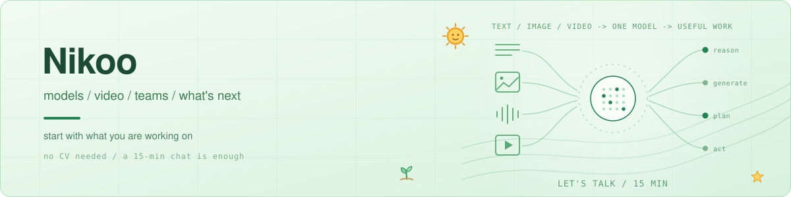

<!-- ==========================================================
     已上线版本。每个可编辑区块都用注释标了出来。
     全局规则：不出现中文姓名、不出现候选人信息、不写未公开的岗位与 HC 细节。
     团队信息只写公开可查的方向和常驻城市，不写成合作客户名单或实时招聘清单。
     视觉口径：浅绿主题 + 原创蜡笔涂鸦贴纸（手绘 SVG，不使用任何现成卡通角色）。
     语言口径：中文短句，正文尽量白话，术语能不写就不写，必要时只作标签。
     改稿清单见 EDIT-ME.md
     ========================================================== -->

<picture>
  <source media="(prefers-color-scheme: dark)" srcset="assets/banner-dark-v2.svg">
  
</picture>

<div align="center">

**完整介绍页 → [nikoyyl21.github.io](https://nikoyyl21.github.io/)**　点开即读，无需登录

**做大模型方向的猎头，主要看基础模型与多模态**

`模型怎么练`　`视频怎么生成`　`成本怎么算`　`效果怎么评`

**想聊就点开下面「简单聊 15 mins」看电话**　或加微信 `Hello_le_0502`　15 分钟，可以先不透露姓名和现单位

[方向](#scope) · [自我介绍](#intro) · [可以和谁聊](#who) · [团队地图](#teams) · [怎么联系](#contact) · [English](#english)

</div>

<details>
<summary><b>简单聊 15 mins · 点开看电话</b></summary>

电话 **18357766985**，直接拨或者存一下都行。

一对一沟通，可以先不透露姓名和现单位，不用附简历。

</details>
---

<!-- ===== 区块 1：定位（改这里） ===== -->

## 我在做什么

做大模型方向的猎头，主要看基础模型与多模态。平时读公开的技术报告和论文，也留意团队在方向和分工上的变化。

聊的时候从你做过的具体问题开始：贡献在哪一段、还想继续解什么，不先甩岗位清单。

<!-- ===== 区块 2：方向（改这里，正文写白话） ===== -->

<a name="scope"></a>

## 方向

- **文本基座：预训练与调优**（重点）
  - 预训练数据：素材从哪来、网页和书和代码各占多少、重复和脏数据怎么洗掉、什么算一份好语料
  - 模型结构：模型做多大、堆多少层、注意力怎么改、一次能读多长（上下文），还有没有用「多位专家分工」的省算力做法（MoE）
  - 再调答案：按人的偏好把回答调顺、打分标准靠不靠谱、调完别的题会不会变差
  - 容易忽略的：数据里混进了评测题、分数刷上去但其实没学会、调完反而变笨
  - 我常问的：底子没练好的部分，靠后面调能补回来吗？换个任务还成立吗
- **视频与图像生成**（重点）
  - 数据：视频和图片素材怎么挑、怎么洗、比例怎么配，先决定了生成能不能控得住
  - 怎么生成：画面是一步步从噪声里"描"出来的，骨架怎么搭、长视频前后会不会跳、改图时怎么加条件
  - 照着参考改：给一张参考图，人物前后长得一不一样；一句话能不能改对地方；再用打分模型把效果往上推
  - 语音顺带覆盖，不单独展开
  - 我常问的：效果最后靠什么评？自动分数和真人看的结果差多少
- **训练和推理的工程**
  - 训练：一堆机器怎么分工、机器有没有闲着、跑起来稳不稳
  - 推理：先读懂问题、再一个字一个字往外吐，这两段分开算；算过的存起来少算一遍；生成一千字要花多少钱
  - 容易忽略的：把模型压小省显存，准确率掉多少；机器一挤就变慢
  - 我常问的：服务什么模型、同时来多少请求、改之前是什么水平
- **大模型评测**（横切维度，单独列出）
  - 用什么口径：有标准答案的题看答对多少，开放题看人怎么打分，视频看画面连不连贯；别一套榜单套所有场景
  - 怎么落到线上：离线跑出来的分数，先放给一小部分用户试，再看速度和成本；另外留一组题定期人工复看
  - 容易失真的地方：让模型当裁判，它偏爱自己那类答案；评测题可能早被练过；榜单涨分不等于线上真有用
  - 我常问的：这个分数涨了，最后对业务到底有没有用

<!-- ===== 区块 3：自我介绍（口语化、亲近，不写客户名与未证实消息） ===== -->

<a name="intro"></a>

## 自我介绍

我是 Nikoo，长期深耕 AI 赛道，平时会持续跟进行业一线动态，同步各家团队的最新进展、组织变化与圈内真实信息。之前也陆续帮不少同学梳理过职业困惑、岗位选择、面试和谈薪相关的咨询。对我来说，不只是推荐机会，更希望做一个行业信息的交流窗口。哪怕你现阶段没有看机会的打算，也欢迎添加微信，一起聊聊技术、行业见闻，交个同赛道的朋友，后续有消息也可以互通呀

<details>
<summary><b>一段不正经的自我介绍（点开看看）</b></summary>

<br>

```js
const nikoo = {
  role: "大模型方向猎头",
  focus: ["文本基座", "视频图像", "大模型评测"],
  read: "公开技术报告和团队分工",
  chat: "从你做过的具体问题聊起",
  promises: ["照实说", "不硬推", "不共享给第三方"],
  if (you.asking === "值不值得聊") return "先聊 15 分钟，不用准备简历 :)"
};
// 不是真代码，就是想让你 10 秒内知道我大概是谁、怎么聊
```

</details>

<!-- ===== 区块 4：可以和谁聊（改这里，可复用分人群话术） ===== -->

<a name="who"></a>

## 可以和谁聊

<details>
<summary><b>研究员</b>　想看看方向，或比较不同团队的做法</summary>

<br>

先聊你正在解的问题、负责的是哪一段，再聊下一个问题值不值得继续投入。

</details>

<details>
<summary><b>训练与推理</b>　关心训练效率和推理成本</summary>

<br>

我会问得具体些：多大的集群、跑什么模型、同时来多少请求、多快要有结果、卡在哪。

</details>

<details>
<summary><b>视频与图像</b>　做视频、图像生成的</summary>

<br>

素材怎么配、生成结果怎么控、效果怎么评，这些比岗位清单更值得先聊清楚。

</details>

<details>
<summary><b>暂时不想动的人</b>　只想先了解行业在发生什么</summary>

<br>

不做任何决定也没关系。先匿名聊点近况，也行。

</details>

<!-- ===== 区块 5：常聊的一线团队（公开资料整理，不写实时招聘清单） ===== -->

<a name="teams"></a>

## 常聊的一些团队

按公司归类，写到具体团队、在做的方向和办公地点，目前整理到 18 家。完整版在[介绍页](https://nikoyyl21.github.io/#teams)，可以按城市筛选。

- **阿里 · 千问 / 通义**（杭州 / 北京）：基础模型训练与调优、Qwen-VL 看图答题、智能体与代码方向
- **腾讯 · 混元/微信**（深圳 / 北京）：视频与图像生成、基础模型调优对齐、训练与推理工程
- **字节 · Seed**（北京 / 上海 / 杭州 / 深圳）：基础模型预训练、智能体与代码调优、数据全链路
- **智谱 · GLM**（北京）：GLM 基础模型、多模态与智能体、CodeGeeX 代码方向
- **快手 · 可灵 / Keye / KAT**（北京）：视频生成、看懂视频、文本大模型
- **美团 · LongCat**（北京）：大模型预训练与基础模型、文字生成模型调优
- **阶跃星辰 · Step**（上海 / 北京）：文本大模型、多模态生成、训练与推理工程
- **蚂蚁集团 · 百灵**（杭州 / 北京 / 上海）：行业场景调优、智能体与文字生成调优
- **百度 · 文心**（北京）：基础模型与多模态、图像算法
- **MiniMax**（上海 / 北京）：基础模型全链路、长内容与推理效率
- **小红书 · Dots**（上海 / 杭州 / 北京）：Dots 基础模型整条链路、社区与搜索算法
- **米哈游 · anuttacon**（上海 / 北京）：前沿研究方向、应用调优落地
- **Shopee**（北京 / 上海）：基础模型团队、应用与智能体
- **九坤 · 至知**（北京 / 上海）：至知基座研究院、总部智能体团队
- **盛大**（上海）：智能体算法
- **B站 · 哔哩哔哩**（上海）：多模态与智能体、自研多模态基础模型
- **记忆张量**（上海）：基础模型团队
- **面壁智能**（北京 / 上海）：行业智能体、小模型与工作台

> 按公开资料整理，写的是这些团队长期在做的方向和常见职位画像，不是实时招聘清单。具体岗位、层级、招几个人和办公地点，聊的时候按最新情况说；哪些是我在跟的项目，也只在一对一里讲。

<details>
<summary><b>随手记 · 点开看一句</b></summary>

榜单涨分不等于线上真有用。聊方向的时候，这句我常说。

</details>

<!-- ===== 区块 6：可信度（有公开文章就把链接加在这段） ===== -->

## 聊的时候我在意什么

先听你做过什么。从具体问题和你负责的那一段开始，你的核心诉求以及目前的困惑是什么

给能用的横向信息：同一个方向上不同团队的做法和差别，包括不那么好看的部分，我会照实说。

不合适会直说，不硬推。

<!-- ===== 区块 7：联系（已上线，以后有预约链接或二维码再加行） ===== -->
<!-- 顶部还有一条落地页入口，指向 https://nikoyyl21.github.io/ -->

<a name="contact"></a>

## 怎么联系

| | |
| :--- | :--- |
| 电话 | 点开上方「简单聊 15 mins」查看，直接聊 15 分钟 |
| 微信 | `Hello_le_0502`（加的时候备注一句想聊什么就行） |
| 邮箱 | [18357766985@163.com](mailto:18357766985@163.com)（备选） |

**聊之前，可以先告诉我两件事**：你在做什么，接下来想做什么。不用附简历，也不用先说姓名和单位。

> 照实说：方向和差异，包括不那么好看的部分，我都照实讲。
> 不硬推：不合适就直说，不为了成单推你去做不想做的事。
> 不外传：一对一聊，不共享给第三方，不写进任何公开列表。团队方向都来自公开资料，这里不是实时招聘清单。

<div align="center">

**点开「简单聊 15 mins」看电话，先聊 15 分钟，不用附简历**

</div>

<!-- ===== 区块 8：每周动态（自动，不用手改） ===== -->

## 最近在看的

<!-- WEEKLY-NOTE:START -->
最近更新 2026-11-05　|　最近在看两件事：给回答打分的标准怎么验，以及视频生成的效果到底该怎么评。
<!-- WEEKLY-NOTE:END -->

---

<a name="english"></a>

<!-- ===== 英文版（改这里） ===== -->

## English

I work as a headhunter in the foundation model space, mostly on foundation models and multimodal generation. I read public technical reports and papers, and pay attention to how teams and their focus shift. When we talk, I start with the problem you have actually worked on, not with a job list.

**What I follow** — four areas, each with the questions I usually ask. Text foundation models, from pretraining to tuning: where pretraining data comes from and how it is mixed and cleaned (web pages, books, code, deduplication), how the model is structured (size, layers, attention, context length, mixture-of-experts), whether the scoring standard holds up after tuning, and how much of a weak foundation tuning can actually fix. Video and image generation: how clips and images are picked and cleaned, how a picture is built up step by step from noise, whether longer clips stay consistent, and how reference images and one-line edits are handled; speech is only mentioned in passing. Training and serving: how machines share the work, whether they sit idle, splitting "read the question" from "write the answer", reusing what has already been computed, and what a thousand words cost. Evaluation is a separate track: which score fits which task, how an offline score reaches real users, and where those scores mislead.

**Teams I talk about** — a public-source map of 18 first-party teams and what they work on, grouped by company and city: Alibaba Qwen / Tongyi, Tencent Hunyuan, ByteDance Seed, Zhipu GLM, Kuaishou Kling / Keye / KAT, Meituan LongCat, StepFun, Ant, Baidu, MiniMax, Xiaohongshu Dots, miHoYo anuttacon, Shopee, Ubiquant, Shanda, Bilibili, MemTensor and ModelBest. It lists long-running research directions and where those teams are based, not live openings or headcount. The filterable version is at https://nikoyyl21.github.io/#teams

**A bit about me** — I'm Nikoo. I have been working in the AI space for a long time and stay close to what is happening on the ground: how teams are progressing, how they are reorganising, and what people in the field are actually saying. Over the past year I have also helped many people think through career questions, from choosing between roles and preparing for interviews to talking about compensation. For me this is not just about recommending roles; I would rather be a place to exchange what is happening in the industry. Even if you are not looking at any opportunity right now, feel free to add me on WeChat. We can talk about the technology and what we are seeing, make a friend on the same path, and keep each other posted when something comes up.

**The only ask** — a 15-minute conversation. One-to-one, never shared with third parties, no need to reveal your name or current employer.

**Contact** — open the "15-min chat" panel above to reveal my phone number, or add WeChat `Hello_le_0502`. A short call is enough; no CV, no name, no current employer needed. **Full profile** — https://nikoyyl21.github.io/

---

<picture>
  <source media="(prefers-color-scheme: dark)" srcset="assets/agi-strip-dark.svg">
  
</picture>

<div align="center">

<sub>团队方向均来自公开资料　|　不含候选人信息与未公开岗位细节</sub>

</div>
