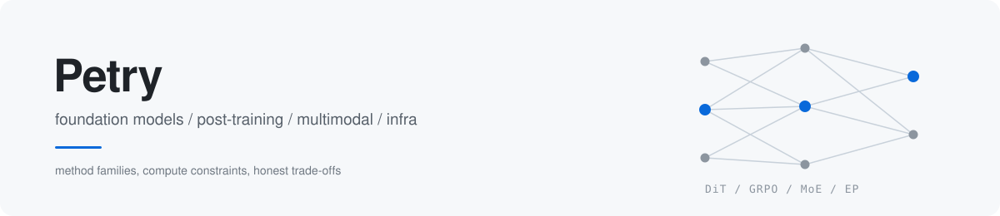

<!-- ==========================================================
     骨架文件，不是终稿。每个可编辑区块都用注释标了出来。
     全局规则：不出现中文姓名、不出现未授权客户名、不出现候选人信息。
     术语原则：写方法族、真实取舍和开放问题，不堆关键词。
     改稿清单见 EDIT-ME.md
     ========================================================== -->

<picture>
  <source media="(prefers-color-scheme: dark)" srcset="assets/banner-dark.svg">
  
</picture>

**我在帮做基模和多模态的研究员，判断下一个值得投入的问题**

`foundation models`　`post-training`　`multimodal generation`　`systems`

[方向](#scope) · [怎么读报告](#method) · [我在找谁](#who) · [怎么联系](#contact) · [English](#english)

---

<!-- ===== 区块 1：定位（改这里） ===== -->

## 我在做什么

以公开技术报告、论文和开源实现为一手材料，跟踪基模与多模态方向的方法演进和组织分工，还原一条路线真正在解什么问题。

聊的是方法取舍、数据配比和算力约束，不是岗位清单。

<!-- ===== 区块 2：方向（改这里，术语可替换） ===== -->

## 方向

| | |
| :--- | :--- |
| **多模态与视频生成** | DiT 与 flow matching、基于 GRPO 的奖励优化（Flow-GRPO / VideoReward）、时空 VAE 压缩比与长时序一致性；可控性和运动物理合理性仍缺可靠的自动评测代理 |
| **后训练与对齐** | DPO / PPO / GRPO 一族、RLVR 与可验证奖励、process reward model、扩散语言模型上的 RL 对齐（dLLM / EBPO）；reward hacking 与 KL 约束的真实代价 |
| **文本大模型** | MoE 专家路由与稀疏激活、预训练数据配比与 mid-training 退火、长上下文的 RoPE 外推与 KV cache 成本；scaling law 之外的数据墙 |
| **语音与 Infra** | 端到端语音的离散 codec token 与流式推理；TP / PP / EP 并行策略、MFU、prefill-decode 分离，以及 SLO 约束下的单位 token 推理成本 |

<!-- ===== 区块 3：方法论（这段是专业度的主要支撑） ===== -->

## 怎么读一份技术报告

1. 按方法族归档，不按产品名归档。同一条路线在不同实现里的差异，比发布顺序更有信息量。
2. 关键结论做多源交叉核验，OpenReview、arXiv、DBLP、机构主页和开源实现互相印证；同名歧义保留候选，不强行合并。
3. 每条判断标注来源与置信度。查不到就写查不到，不补推测，不把推断伪装成事实。

置顶仓库是这套方法的产出：技术图谱、作者索引、方向时间线，全部基于公开资料。

<!-- ===== 区块 4：我在找谁（改这里，可复用分人群话术） ===== -->

## 我在找谁

<b>研究员</b>　想判断方向，或比较不同实现的路线差异

 

从你在做的具体问题聊起，基模能力边界、奖励信号设计，或者一个方法在更大规模上还成不成立。可以直接问我某条路线走到哪一步、瓶颈在哪。

<b>Infra 与系统</b>　关心 MFU、并行策略和推理成本

 

TP / PP / EP 怎么切、prefill-decode 分离是不是真落地、集群拓扑和 SLO 的实际约束，都能摊开讲，包括不那么好看的部分。

<b>多模态与生成</b>　视频、图像、语音生成方向

 

数据配比、时空压缩比、奖励模型怎么建、评测靠 VBench 还是人类偏好对齐，这些比岗位清单更值得先聊清楚。

<b>暂时不想动的人</b>　只想先了解发生了什么

 

不做任何决定也没关系，这类聊天我同样欢迎。

<!-- ===== 区块 5：可信度（有公开文章就把链接加在这段） ===== -->

## 为什么可以跟我聊

按方法族和算力约束做梳理，不按 JD 关键词做匹配。

能说清一条路线为什么被选中、代价是什么，以及同一技术维度上不同实现的取舍。

不合适会直说，不硬推。

<!-- ===== 区块 6：联系（改这里，必填） ===== -->

## 怎么联系

| | |
| :--- | :--- |
| 邮箱 | `【待填：工作邮箱】` |
| 15 分钟预约 | `【待填：预约链接】` |
| 微信 / 飞书 | `【待填：二维码】` |

> 一对一沟通，不共享给任何第三方。可以先不透露姓名和现单位，只聊方向。你的信息不会出现在任何公开仓库或公开列表里。

**预约 15 分钟，先匿名聊方向**

<!-- ===== 区块 7：每周动态（自动，不用手改） ===== -->

## 最近在看的

<!-- WEEKLY-NOTE:START -->
最近更新 2026-11-05　|　最近在看扩散语言模型上的 RL 对齐（dLLM / EBPO），以及视频生成奖励模型在 flow matching 下的可迁移性与 reward hacking。
<!-- WEEKLY-NOTE:END -->

---

<!-- ===== 英文版（改这里） ===== -->

## English

I track how foundation model and multimodal methods actually evolve, using public technical reports, papers and open-source implementations as primary sources.

**What I cover** — DiT and flow matching for video generation, GRPO-style reward optimization, RLVR and post-training alignment including diffusion language models, MoE routing, long-context extrapolation and KV cache economics, streaming speech codecs, and the systems side: TP / PP / EP parallelism, MFU, prefill-decode disaggregation.

**How I read a report** — archive by method family rather than product name, cross-check claims against OpenReview, arXiv, DBLP and institutional pages, keep ambiguous author candidates separate, and label every conclusion with a source and a confidence level.

**The only ask** — a 15-minute anonymous conversation. One-to-one, never shared with third parties, no need to reveal your name or current employer.

`【待填：工作邮箱】` · `【待填：预约链接】`

---

公开资料整理　|　不含候选人信息与在招团队细节

