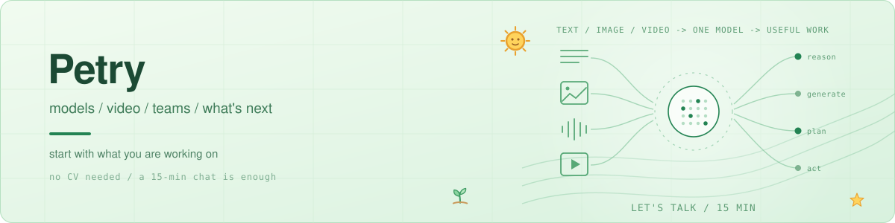

<!-- ==========================================================
     已上线版本。每个可编辑区块都用注释标了出来。
     全局规则：不出现中文姓名、不出现候选人信息、不写未公开的岗位与 HC 细节。
     团队信息只写公开可查的方向和常驻城市，不写成合作客户名单或实时在招 JD。
     语言口径：中文短句，术语只做标签，正文写具体场景和「我会问什么」。
     改稿清单见 EDIT-ME.md
     ========================================================== -->

<picture>
  <source media="(prefers-color-scheme: dark)" srcset="assets/banner-dark.svg">
  
</picture>

**完整介绍页 → [nikoyyl21.github.io](https://nikoyyl21.github.io/)**　点开即读，无需登录

**做大模型方向的猎头，主要看基模与多模态**

`foundation models`　`post-training`　`multimodal generation`　`systems`

**想聊就点开下面「简单聊 15 mins」看电话**　或加微信 `Hello_le_0502`　15 分钟，可以先不透露姓名和现单位

[方向](#scope) · [自我介绍](#intro) · [可以和谁聊](#who) · [团队地图](#teams) · [怎么联系](#contact) · [English](#english)

<b>简单聊 15 mins · 点开看电话</b>

电话 **18357766985**，直接拨或者存一下都行。

一对一沟通，可以先不透露姓名和现单位，不用附简历。

---

<!-- ===== 区块 1：定位（改这里） ===== -->

## 我在做什么

做大模型方向的猎头，主要看基模与多模态。平时读公开的技术报告和论文，也留意团队在方向和分工上的变化。

聊的时候从你做过的具体问题开始：贡献在哪一段、还想继续解什么，不先甩岗位清单。

<!-- ===== 区块 2：方向（改这里，术语只做标签） ===== -->

## 方向

- **文本基座 / 后训练**（重点）
  - 预训练：数据怎么配、MoE 路由是不是真省、长上下文的成本怎么算
  - 后训练：DPO / GRPO 这类方法怎么选、奖励信号怎么验、对齐之后能力有没有掉
  - 容易忽略的：奖励被刷、对齐后通用能力掉了多少、数据还能撑多久
  - 我常问的：这次涨分主要来自基座，还是后训练？换个任务还成立吗
- **多模态 / 视频与图像生成**（重点）
  - 数据：视频和图像语料怎么清洗、怎么配比，基本决定生成能不能控得住
  - 生成结构：DiT / flow matching 这类框架、长视频的时序一致性、图像侧怎么加控制条件
  - 参考与编辑：主体一致性、按指令改图改视频、用奖励模型继续优化效果
  - 语音顺带覆盖，不单独展开
  - 我常问的：效果最后靠什么评？自动分数和真人看的结果差多少
- **Infra / 推理系统**
  - 训练：并行怎么切、集群利用率、训练稳不稳
  - 推理：prefill-decode 分离、KV cache、单个 token 的成本
  - 容易忽略的：量化之后精度掉了多少、调度一挤就变慢
  - 我常问的：服务什么模型、并发多少、优化前的基线是什么
- **大模型评测**（横切维度，单独列出）
  - 用什么口径：能验答案的任务看通过率，开放生成看人怎么评，视频看时序一致性，别一套榜单套所有场景
  - 怎么落到线上：离线指标、灰度 A/B、时延和成本、人工抽检的回归集
  - 容易失真的地方：judge 偏爱自己的答案、评测集被污染、榜单涨分不等于线上有用
  - 我常问的：这个分数涨了，最后对业务到底有没有用

<!-- ===== 区块 3：自我介绍（口语化、亲近，不写客户名与未证实消息） ===== -->

## 自我介绍

我是 Petry，长期深耕 AI 赛道，平时会持续跟进行业一线动态，同步各家团队的最新进展、组织变化与圈内真实信息。之前也陆续帮不少同学梳理过职业困惑、岗位选择、面试和谈薪相关的咨询。对我来说，不只是推荐机会，更希望做一个行业信息的交流窗口。哪怕你现阶段没有看机会的打算，也欢迎添加微信，一起聊聊技术、行业见闻，交个同赛道的朋友，后续有消息也可以互通呀

<!-- ===== 区块 4：可以和谁聊（改这里，可复用分人群话术） ===== -->

## 可以和谁聊

<b>研究员</b>　想看看方向，或比较不同团队的做法

 

先聊你正在解的问题、负责的是哪一段，再聊下一个问题值不值得继续投入。

<b>Infra 与系统</b>　关心训练效率和推理成本

 

我会问得具体些：多大的集群、服务什么模型、并发和延迟目标是什么、瓶颈卡在哪。

<b>多模态与生成</b>　做视频、图像生成的

 

数据怎么配、生成结果怎么控、效果怎么评，这些比岗位清单更值得先聊清楚。

<b>暂时不想动的人</b>　只想先了解行业在发生什么

 

不做任何决定也没关系。先匿名聊点近况，也行。

<!-- ===== 区块 5：常聊的一线团队（公开资料整理，不写在招 JD） ===== -->

## 常聊的一线团队

按公司归类，写到具体团队、在做的方向和办公地点。完整版在[介绍页](https://nikoyyl21.github.io/#teams)，可以按城市筛选。

- **阿里 · 千问 / 通义**（杭州 / 北京）：基础模型预训练与后训练、Qwen-VL 多模态、Agent 与 Code 方向
- **腾讯 · 混元**（深圳 / 北京）：视频与图像生成、基模后训练对齐、训练与推理系统
- **字节 · Seed**（北京 / 上海 / 杭州）：基座预训练、Agentic 与 Code 后训练、数据全链路
- **智谱 · GLM**（北京）：GLM 基座、多模态与 Agent、CodeGeeX 代码方向
- **快手 · 可灵 / Keye / KAT**（北京）：视频生成、多模态理解、文本基座
- **美团 · LongCat**（北京）：LLM 预训练与基模、dLLM 与 RL 对齐
- **阶跃星辰 · Step**（上海 / 北京）：文本基座 MoE、多模态生成、训练与推理系统
- **蚂蚁集团 · 百灵**（杭州 / 北京 / 上海）：垂域后训练、Agent / dLLM 后训练
- **百度 · 文心**（北京）：基模与多模态、图像算法
- **MiniMax**（上海）：基座全链路、长上下文与推理效率

> 按公开资料整理，写的是这些团队长期在做的方向和常见职位画像，不是实时在招 JD。具体岗位、层级、HC 和办公地点，聊的时候按最新情况说；哪些是我在跟的项目，也只在一对一里讲。

<!-- ===== 区块 6：可信度（有公开文章就把链接加在这段） ===== -->

## 聊的时候我在意什么

先听你做过什么。从具体问题和你负责的那一段开始，不拿 JD 关键词套人。

给能用的横向信息：同一个方向上不同团队的做法和差别，包括不那么好看的部分，我会照实说。

不合适会直说，不硬推。

<!-- ===== 区块 7：联系（已上线，以后有预约链接或二维码再加行） ===== -->
<!-- 顶部还有一条落地页入口，指向 https://nikoyyl21.github.io/ -->

## 怎么联系

| | |
| :--- | :--- |
| 电话 | 点开上方「简单聊 15 mins」查看，直接聊 15 分钟 |
| 微信 | `Hello_le_0502`（加的时候备注一句想聊什么就行） |
| 邮箱 | [18357766985@163.com](mailto:18357766985@163.com)（备选） |

> 一对一聊，不会共享给任何第三方；可以先不透露姓名和现单位。你的信息也不会出现在任何公开仓库或公开列表里。

**点开「简单聊 15 mins」看电话，先聊 15 分钟，不用附简历**

<!-- ===== 区块 8：每周动态（自动，不用手改） ===== -->

## 最近在看的

<!-- WEEKLY-NOTE:START -->
最近更新 2026-11-05　|　最近在看两件事：后训练里的奖励信号怎么验，以及视频生成的效果到底该怎么评。
<!-- WEEKLY-NOTE:END -->

---

<!-- ===== 英文版（改这里） ===== -->

## English

I work as a headhunter in the foundation model space, mostly on foundation models and multimodal generation. I read public technical reports and papers, and pay attention to how teams and their focus shift. When we talk, I start with the problem you have actually worked on, not with a job list.

**What I follow** — four areas, each with the questions I usually ask. Foundation models and post-training: data mixture, whether MoE routing really saves compute, how rewards are verified, and whether a gain still holds on another task. Multimodal generation, mainly video and image: data curation, DiT / flow matching, consistency over longer clips, reference-based and instruction-driven editing; speech is only mentioned in passing. Systems and inference: parallelism, cluster utilisation, prefill-decode disaggregation, KV cache and unit token cost. LLM evaluation is a separate track: which metric fits which task, how offline scores reach production, and where those scores mislead.

**Teams I talk about** — a public-source map of first-party teams and what they work on, grouped by company and city: Alibaba Qwen / Tongyi, Tencent Hunyuan, ByteDance Seed, Zhipu GLM, Kuaishou Kling / Keye / KAT, Meituan LongCat, StepFun, Ant, Baidu and MiniMax. It lists long-running research directions and where those teams are based, not live openings or headcount. The filterable version is at https://nikoyyl21.github.io/#teams

**A bit about me** — I'm Petry. I have been working in the AI space for a long time and stay close to what is happening on the ground: how teams are progressing, how they are reorganising, and what people in the field are actually saying. Over the past year I have also helped many people think through career questions, from choosing between roles and preparing for interviews to talking about compensation. For me this is not just about recommending roles; I would rather be a place to exchange what is happening in the industry. Even if you are not looking at any opportunity right now, feel free to add me on WeChat. We can talk about the technology and what we are seeing, make a friend on the same path, and keep each other posted when something comes up.

**The only ask** — a 15-minute conversation. One-to-one, never shared with third parties, no need to reveal your name or current employer.

**Contact** — open the "15-min chat" panel above to reveal my phone number, or add WeChat `Hello_le_0502`. A short call is enough; no CV, no name, no current employer needed. **Full profile** — https://nikoyyl21.github.io/

---

<picture>
  <source media="(prefers-color-scheme: dark)" srcset="assets/agi-strip-dark.svg">
  
</picture>

团队方向均来自公开资料　|　不含候选人信息与未公开岗位细节

